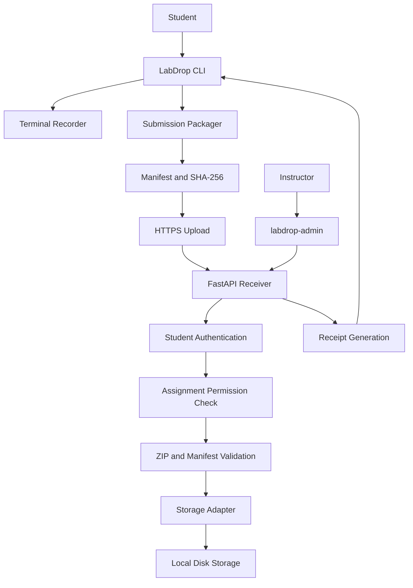

# LabDrop — Project Specification

**Version:** 1.0  
**Status:** MVP Development  
**Project Type:** Cross-platform CLI and instructor-controlled submission receiver

---

# 1. Project Overview

LabDrop is a cross-platform command-line tool that allows college students to submit programming lab assignments along with terminal execution logs to an instructor-controlled receiver.

It eliminates the need for students to log into Google Drive, navigate shared folders or manually upload assignment files from college laboratory computers.

Students interact with LabDrop through a CLI. An instructor-operated FastAPI receiver authenticates submissions, validates uploaded files and stores them in instructor-controlled storage.

**Core principle:** Students submit through LabDrop without receiving direct access to the instructor's Google Drive or storage system.

# 2. Problem Statement

Students commonly submit programming assignments by:

1. Logging into a cloud storage account on a shared laboratory computer.
2. Navigating to the appropriate assignment folder.
3. Uploading source files manually.
4. Repeating the process for every assignment.

This process is time-consuming and creates unnecessary account-security and file-management problems.

Additionally, instructors may want students to submit terminal execution logs alongside their source code to provide context about how the programs were executed.

LabDrop aims to simplify this workflow into a few CLI commands.

# 3. Project Objectives

1. Provide a simple CLI for assignment submission.
2. Record interactive terminal sessions as readable text logs.
3. Automatically package source files, logs and a submission manifest.
4. Authenticate students using individually issued tokens.
5. Validate uploads and file integrity on the server.
6. Prevent unauthorized access to other students' submissions.
7. Provide unique submission receipts and verification.
8. Give instructors control over students, assignments, permissions and storage.
9. Support Linux first, followed by Windows.
10. Keep the architecture extensible for future Google Drive integration.

# 4. System Architecture

The system consists of two independent applications:

- **Student CLI:** Runs on student computers and handles terminal recording, packaging, authentication and uploading.
- **Instructor Receiver:** Runs on an instructor-controlled host and handles authentication, validation, storage and verification.

### High-level architecture



### Architectural boundaries

- CLI and server must remain separate applications.
- The CLI must never import server internals.
- The server must never depend on CLI internals.
- Shared data models, if necessary, should live in a small `common/` module.
- Storage must be accessed through an adapter interface.
- The MVP uses local disk storage.
- Google Drive integration is a later milestone.

# 5. Student Workflow

The intended student workflow is:

### Step 1: Start terminal recording

```bash
labdrop capture
```

A genuine interactive shell opens.

### Step 2: Perform laboratory work

The student executes commands normally:

```bash
gcc program.c -o a.out
./a.out
```

The student enters input and observes the program output.

LabDrop records the visible terminal session.

### Step 3: Exit recording

```bash
exit
```

The recorder saves the session to:

```text
terminal_log.txt
```

### Step 4: Submit assignment

```bash
labdrop submit ./Lab05 --assignment OS-Lab-05
```

The CLI:

1. Scans the assignment directory.
2. Finds the corresponding terminal log.
3. Identifies included and excluded files.
4. Displays a submission preview.
5. Generates a manifest and checksums.
6. Requests the student's authentication token.
7. Packages and uploads the submission.
8. Displays the server-generated receipt.

### Step 5: Verify submission

```bash
labdrop verify RECEIPT_ID
```

The student authenticates using their token.

The server verifies that the receipt belongs to that student and returns the submission status.

# 6. Terminal Recording

Terminal recording is one of LabDrop's core features and should be implemented and tested before the rest of the platform.

### 6.1 Requirements

- Launch the user's default interactive shell.
- Preserve normal interactive terminal behavior.
- Capture commands and visible terminal output in chronological order.
- Record standard output and standard error as displayed in the terminal.
- Support interactive program input.
- Handle backspaces, carriage returns, ANSI escape sequences, arrow keys and tab completion.
- Correctly handle Ctrl+C, Ctrl+D and normal shell termination.
- Clean up child processes and terminal resources.
- Do not record input when terminal echo is disabled.
- Never log authentication tokens or hidden password input.

### 6.2 Implementation

Linux:
- Use a genuine pseudo-terminal (PTY).
- Use Python's PTY facilities or an appropriate PTY implementation.
- Use `pyte` as the terminal emulator to interpret terminal control sequences.
- Render the resulting terminal state into a readable text log.

Windows:
- Implement a separate ConPTY-based adapter.
- Do not claim Windows recording support until tested on Windows.

### 6.3 Output location

Default:

```bash
labdrop capture
```

Writes:

```text
./terminal_log.txt
```

Custom path:

```bash
labdrop capture --output ./Lab05/terminal_log.txt
```

Submission log discovery:

1. Check the assignment directory for `terminal_log.txt`.
2. If unavailable, check the current working directory.
3. Allow an explicit path through `--log PATH`.
4. Report a clear error if no log is found.

The selected log must be included in the submission archive.

### 6.4 Important limitation

Terminal logs are generated locally and can be edited by students.

They provide execution context but are not cryptographic proof that a particular program was executed or that the displayed output is authentic.

Do not describe them as tamper-proof evidence.

# 7. Submission Packaging

The packager scans an assignment directory and creates a submission archive.

### 7.1 Included files

- Source code.
- Required assignment files.
- `terminal_log.txt`.
- Submission manifest.

### 7.2 Excluded files

Exclude unnecessary files, including:

- `.git/`
- `.venv/`
- `venv/`
- `__pycache__/`
- `node_modules/`
- Temporary and editor files.
- Compiled binaries such as `a.out` and `*.exe`.
- Object files such as `*.o`.
- Shared libraries such as `*.so`.
- Compiled Java classes such as `*.class`.
- Python bytecode such as `*.pyc`.

Make exclusions configurable where practical.

Do not blindly exclude legitimate source files because their extensions happen to resemble binary extensions.

### 7.3 Submission preview

Before uploading, show:

```text
LabDrop Submission Preview

Assignment: OS-Lab-05

Included:
  program.c
  terminal_log.txt

Excluded:
  a.out

Total included files: 2

Continue with submission? [y/N]
```

### 7.4 Manifest

Generate a manifest containing:

- Assignment identifier.
- Relative file paths.
- File sizes.
- SHA-256 checksums.
- Submission format/version information.

The manifest must not be treated as trusted merely because it was generated by the client.

The server independently validates the manifest and recomputes checksums against uploaded file contents.

# 8. Student Authentication

Students authenticate using individual tokens issued by the instructor.

### 8.1 Token generation

- Generate tokens using Python's `secrets` module.
- Tokens must contain sufficient cryptographic randomness.
- Each student receives an individually assigned token.
- Tokens are generated and displayed only through an authorized provisioning process.
- The server stores only token hashes.
- Token revocation must be supported.
- Optional expiry dates must be supported.

Since tokens are high-entropy random secrets, SHA-256 or a stronger suitable cryptographic hash may be used for storage.

### 8.2 Token entry

Use Python's `getpass` to collect student tokens.

Never:
- Put tokens in command-line arguments.
- Print tokens in logs.
- Save tokens to disk by default.
- Include tokens in submission archives.
- Trust a student identity or roll number supplied by the client.

### 8.3 Identity mapping

The server maps the authenticated token to:

- Student identity.
- Roll number.
- Course permissions.
- Assignment permissions.
- Token status and expiry.

Student identity must always come from server-side authentication data.

### 8.4 Shared computer considerations

Tokens must not persist on shared laboratory computers by default.

Students must be able to revoke compromised tokens and receive replacements.

The system must not claim that token authentication proves the physical identity of the person submitting an assignment.

# 9. Instructor-Side Provisioning Utility

Provide a separate instructor utility:

```bash
labdrop-admin
```

This utility is responsible for managing students, tokens, courses, assignments and permissions.

### 9.1 Required commands

Proposed CLI interface:

```bash
labdrop-admin --help

labdrop-admin register-student \
  --roll 23 \
  --course OS

labdrop-admin create-token \
  --roll 23 \
  --course OS

labdrop-admin revoke-token \
  --roll 23 \
  --course OS

labdrop-admin assign-permission \
  --roll 23 \
  --assignment OS-Lab-05
```

The exact syntax and supported arguments must be documented in the README.

### 9.2 Provisioning requirements

- Only authorized instructors can perform administrative operations.
- Token creation must not be exposed through an unauthenticated public endpoint.
- Display newly generated tokens only once.
- Store only token hashes.
- Support token revocation and expiry.
- Support course and assignment-level permissions.
- Maintain an audit trail of administrative operations.

The instructor distributes tokens privately using an appropriate existing communication method.

### 9.3 Assignment management

The instructor must be able to define assignments and their associated courses.

The receiver must validate that a student is authorized to submit to the requested assignment.

# 10. CLI Commands

### 10.1 Student CLI

Required commands:

```bash
labdrop --help

labdrop --version

labdrop capture [--output PATH]

labdrop submit DIRECTORY \
  --assignment ASSIGNMENT_ID \
  [--log PATH]

labdrop configure

labdrop status

labdrop history

labdrop verify RECEIPT_ID
```

### 10.2 Command behavior

| Command | Purpose |
|---|---|
| `--help` | Display available commands and usage. |
| `--version` | Display installed version. |
| `capture` | Start interactive terminal recording. |
| `submit` | Package and upload an assignment. |
| `configure` | Configure receiver URL and non-secret client settings. |
| `status` | Display receiver connectivity and client configuration status. |
| `history` | Display the authenticated student's previous submissions. |
| `verify` | Verify a specific submission receipt. |

### 10.3 History and verification security

- Require authentication for accessing submission history.
- A student may only see their own submissions.
- Verification must require the student's token.
- Never allow receipt IDs to be used as unrestricted access credentials.

# 11. Receipt Generation and Submission Versioning

Every accepted submission receives a unique receipt ID.

Example:

```text
LD-2026-K7Q4X9M2
```

Requirements:

- Receipt IDs must contain a random suffix.
- Never use sequential, predictable receipt IDs.
- The server generates the receipt ID.
- The server generates the authoritative submission timestamp.
- Ignore client-provided timestamps.
- Every resubmission creates a new immutable version.
- Never silently overwrite an earlier submission.
- Return a new receipt ID for each accepted version.
- History must display previous versions.
- Students must not be able to access another student's receipt data.

Submitting the same assignment multiple times must create separate records.

# 12. FastAPI Receiver

The receiver is responsible for:

1. Accepting authenticated uploads.
2. Validating student tokens.
3. Checking course and assignment permissions.
4. Validating uploaded archives.
5. Validating manifests.
6. Recomputing file checksums.
7. Storing submissions.
8. Generating receipts.
9. Maintaining submission history.
10. Verifying ownership and submission integrity.

### 12.1 Storage

The MVP uses local disk storage.

SQLite stores submission metadata, authentication metadata and other required records.

Storage should be accessed through an adapter interface so that additional backends can be introduced later.

### 12.2 Security

- Never execute submitted code.
- Never trust client-provided student identities.
- Never trust client-provided timestamps.
- Never trust client-provided checksums without recomputation.
- Prevent students from listing, reading, modifying or deleting other students' submissions.
- Maintain an audit log.
- Implement rate limiting.
- Enforce assignment permissions.
- Store uploaded files outside publicly served directories.

# 13. ZIP and Upload Security

The server must treat uploaded archives as untrusted input.

### 13.1 Archive validation

Reject archives containing:

- Path traversal entries.
- Absolute paths.
- Symlinks.
- Duplicate archive paths.
- Invalid or unexpected manifest entries.
- Unsupported archive structures.

Validate file paths before extraction and ensure all resolved paths remain within the intended storage directory.

### 13.2 Initial resource limits

Use configurable initial limits:

| Limit | Default |
|---|---:|
| Maximum compressed archive size | 25 MB |
| Maximum total uncompressed size | 100 MB |
| Maximum individual file size | 10 MB |
| Maximum file count | 200 |
| Maximum compression ratio | 100:1 |

Reject submissions exceeding any configured limit.

Do not rely solely on declared ZIP metadata. Enforce limits while processing the actual archive contents.

### 13.3 Integrity verification

- Validate manifest structure.
- Check that manifest paths match the archive contents.
- Recompute SHA-256 checksums.
- Reject missing files, unexpected files and checksum mismatches.
- Store server-generated metadata and timestamps.

SHA-256 verifies file integrity. It does not prove authorship or authenticity of the original terminal log.

# 14. Deployment

### 14.1 Local development

The local development receiver runs at:

```text
http://127.0.0.1:8000
```

This address is only intended for communication from the same machine.

### 14.2 Production deployment

The receiver must run on a separately hosted machine accessible to college laboratory computers.

Possible deployment options:

- College network server.
- Virtual private server.
- Securely configured cloud host.

Production must use HTTPS.

Do not expose the development server directly to the public internet.

### 14.3 Network considerations

Document:

- Receiver URL configuration.
- Firewall requirements.
- Outbound HTTPS connectivity.
- Proxy compatibility.
- Network restrictions.
- Server availability requirements.

Actual college network connectivity must be tested before claiming the system is deployable in the laboratory.

# 15. Platform Support

### Linux — First priority

- Develop using WSL2 Ubuntu.
- Maintain compatibility with native Ubuntu.
- Do not use WSL-specific APIs or paths in application code.
- Test on Ubuntu 22.04 and Ubuntu 24.04.

### Windows — Later milestone

- Implement a separate Windows ConPTY adapter.
- Preserve the same CLI interface where practical.
- Test on actual Windows environments before claiming support.
- Do not substitute a non-interactive subprocess implementation and describe it as ConPTY support.

### Installation considerations

College laboratory computers may have restricted permissions.

Investigate self-contained installation options such as:

- pipx, where Python and package installation are available.
- Python zipapp.
- PyInstaller executable.

The installation strategy must account for the Python version and permissions available on target machines.

The project requires Python 3.10 or later.

# 16. Technology Stack

| Component | Technology |
|---|---|
| Language | Python 3.10+ |
| CLI framework | Typer |
| Terminal formatting | Rich |
| Terminal recording | PTY |
| Terminal emulation | pyte |
| Backend | FastAPI |
| Data validation | Pydantic |
| HTTP client | HTTPX |
| Metadata database | SQLite |
| File packaging | ZIP |
| File integrity | SHA-256 |
| Authentication | Python `secrets`, secure token hashing |
| Testing | pytest |
| Linting | Ruff |
| CI/CD | GitHub Actions |

Use stable, compatible dependency versions and document them in `pyproject.toml`.

# 17. Repository Structure

Use the following logical structure:

```text
labdrop/
│
├── labdrop/
│   ├── cli/
│   │   ├── commands/
│   │   ├── recorder/
│   │   │   ├── base.py
│   │   │   ├── linux.py
│   │   │   └── windows.py
│   │   ├── packager/
│   │   ├── auth/
│   │   └── client/
│   │
│   ├── server/
│   │   ├── main.py
│   │   ├── auth.py
│   │   ├── submissions.py
│   │   ├── storage/
│   │   └── drive_adapter/
│   │
│   └── common/
│       └── models.py
│
├── tests/
│   ├── cli/
│   ├── recorder/
│   ├── packager/
│   ├── server/
│   └── security/
│
├── pyproject.toml
├── README.md
├── SPEC.md
├── AGENTS.md
├── .gitignore
└── LICENSE
```

The Windows recorder and Drive adapter may remain unimplemented until their respective milestones.

Do not create empty placeholder modules and describe them as completed functionality.

# 18. Required Automated Tests

Tests must validate actual behavior, not merely assert that functions or classes exist.

### 18.1 Terminal recorder

- Interactive shell launches.
- Commands and output are recorded.
- Multiple commands preserve chronological order.
- Interactive input works.
- Backspaces and carriage returns are handled.
- ANSI control sequences are interpreted correctly.
- Arrow keys and tab completion do not corrupt the log.
- Hidden input is not recorded.
- Ctrl+C and Ctrl+D are handled.
- Shell exit cleans up child processes and terminal resources.

### 18.2 Packager

- Directory scanning.
- File inclusion and exclusion.
- Compiled binary exclusion.
- Submission preview.
- ZIP generation.
- Manifest generation.
- SHA-256 checksum calculation.
- Correct terminal log discovery.
- Explicit `--log` behavior.

### 18.3 Authentication

- Valid token.
- Invalid token.
- Revoked token.
- Expired token.
- Unauthorized course access.
- Unauthorized assignment access.
- Token rotation or replacement.

### 18.4 Server security

- ZIP path traversal.
- Absolute paths.
- Symlink entries.
- Duplicate archive paths.
- Zip bombs.
- Individual file size limits.
- Total compressed and uncompressed size limits.
- File-count limits.
- Invalid manifests.
- Checksum mismatches.
- Rate limiting.
- Unauthorized access.

### 18.5 Submission management

- Successful upload.
- Duplicate submission handling.
- Immutable submission versioning.
- Receipt generation.
- Receipt verification.
- History retrieval.
- Unauthorized receipt access.
- One student attempting to read another student's submission.
- Server-authoritative timestamps.

# 19. Reference Test Scenario

Use the following C program to test the entire workflow.

### 19.1 Assignment structure

```text
Lab05/
└── program.c
```

### 19.2 Sample program

```c
#include <stdio.h>

int main() {
    int a, b;

    printf("Enter two numbers: ");
    scanf("%d %d", &a, &b);

    printf("Sum = %d\n", a + b);

    return 0;
}
```

### 19.3 Start recording

From the project root:

```bash
labdrop capture
```

Inside the captured shell:

```bash
cd Lab05
gcc program.c -o a.out
./a.out
```

Enter:

```text
5 10
```

Expected output:

```text
Enter two numbers: 5 10
Sum = 15
```

Run again:

```bash
./a.out
```

Enter:

```text
20 30
```

Expected output:

```text
Enter two numbers: 20 30
Sum = 50
```

Exit:

```bash
exit
```

### 19.4 Verify terminal log

The generated `terminal_log.txt` must contain:

- The commands executed.
- Both program executions.
- Both input values, where visibly echoed.
- Both corresponding outputs.
- Correct chronological ordering.

### 19.5 Submit

From the project root:

```bash
labdrop submit ./Lab05 --assignment OS-Lab-05
```

Expected preview:

```text
Included:
  program.c
  terminal_log.txt

Excluded:
  a.out
```

After authentication and successful upload, the server returns a unique receipt ID.

### 19.6 Verify

```bash
labdrop verify RECEIPT_ID
```

Expected result:

- Receipt belongs to the authenticated student.
- Submission exists.
- Assignment identifier matches.
- Server timestamp is displayed.
- Integrity verification succeeds.

Attempting to verify another student's receipt with the wrong student's token must fail without revealing that student's submission data.

# 20. CI and Code Quality

GitHub Actions must run tests on:

- Ubuntu 22.04.
- Ubuntu 24.04.

Test Python versions:

- Python 3.10.
- Python 3.11 or later, within the supported CI matrix.

Required checks:

```bash
ruff check .
```

```bash
python -m pytest -v
```

CI must install dependencies explicitly and run the actual test suite.

Do not mark CI as successful by skipping failing tests or hiding incomplete functionality.

# 21. README Requirements

The README must contain:

1. Project overview.
2. Problem statement.
3. Features.
4. Architecture diagram using Mermaid.
5. Technology stack.
6. Installation instructions.
7. Student CLI usage.
8. Instructor setup and provisioning.
9. Exact instructor utility command usage.
10. Example terminal log.
11. Example submission preview.
12. Example receipt.
13. Authentication model.
14. Security model.
15. Deployment instructions.
16. Known limitations.
17. Testing instructions.
18. Future improvements.

The README must distinguish implemented functionality from planned functionality.

# 22. Security and Privacy Principles

LabDrop must follow these principles:

- No student Google login.
- No direct student access to instructor storage.
- No trust in client-provided identity.
- No execution of submitted code on the receiver.
- No silent overwriting of submissions.
- No public access to student submissions.
- No tokens in command arguments or logs.
- No credentials committed to Git.
- No false claims about terminal log authenticity.
- No sequential or guessable receipt IDs.
- No unauthenticated instructor provisioning.

Never commit:

- Real student tokens.
- API keys.
- `.env` files.
- Cloud credentials.
- Real submissions.
- Databases containing real student data.

# 23. Future Improvements

These are explicitly outside the initial MVP:

- Google Drive storage adapter.
- Windows ConPTY recorder.
- Self-contained Windows installer.
- Self-contained Linux distribution.
- Instructor web dashboard.
- Advanced submission analytics.
- Assignment deadlines and automatic late-submission detection.
- Additional cloud storage providers.
- More advanced audit and monitoring capabilities.

Do not implement these before the core Linux MVP works reliably.

# 24. Definition of Done — MVP

The MVP is considered complete when all the following conditions are satisfied:

1. LabDrop installs and runs in WSL2 Ubuntu.
2. Linux terminal recording works through a genuine interactive shell.
3. The student can compile and run a C program with multiple inputs.
4. Commands and visible output are captured correctly.
5. Hidden input is not recorded.
6. The terminal log is readable and saved to the expected location.
7. The packager includes source files and the terminal log.
8. Compiled binaries such as `a.out` appear in the excluded-file preview.
9. The manifest contains correct checksums.
10. The student can authenticate using an instructor-issued token.
11. The CLI uploads the archive to the FastAPI receiver.
12. The server validates the archive, manifest and checksums.
13. The server stores the submission and generates a unique receipt.
14. The student can verify their receipt.
15. Resubmissions create immutable versions.
16. Another student's token cannot access, modify or delete the submission.
17. Automated tests pass.
18. Ruff reports no linting errors.
19. README documents actual installation and usage.
20. Incomplete features are explicitly documented.

**MVP scope:** Linux CLI, interactive terminal recording, submission packaging, token authentication, FastAPI receiver, local disk storage and receipt verification.

Windows support and Google Drive integration are later milestones, not MVP requirements.

---

**End of Specification**